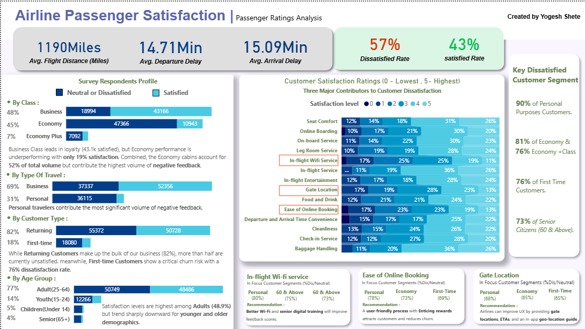

# ✈️ Airline Passenger Satisfaction & Ratings Analysis

A comprehensive **Power BI Data Analytics Project** examining airline passenger feedback to identify key dissatisfaction drivers, customer segment behaviors, and strategic areas for service improvement.

---

## 📌 Executive Summary

Understanding passenger sentiment is critical to reducing churn and driving brand loyalty in modern aviation. This interactive dashboard analyzes survey responses across passenger demographics, flight details, and service quality ratings ($0$ to $5$) to pinpoint operational bottlenecks and recommend data-driven solutions.

### 🔑 Key Performance Indicators (KPIs)
* **Average Flight Distance:** 1,190 Miles
* **Average Departure Delay:** 14.71 Mins
* **Average Arrival Delay:** 15.09 Mins
* **Overall Customer Dissatisfaction Rate:** **57%** (Neutral or Dissatisfied)
* **Overall Customer Satisfaction Rate:** **43%**

---

## 📊 Dashboard Preview

 

---

## 🎯 Key Business Insights

### 1. Survey Respondents Profile
* **By Travel Class:**
  * **Business Class:** High loyalty with **43,166 satisfied passengers** vs. 18,994 neutral/dissatisfied.
  * **Economy & Economy Plus:** Economy performance is lagging, showing only **19% satisfaction**. Combined, Economy cabins represent **52% of total passenger volume** but generate the highest volume of negative feedback.
* **By Travel Type:**
  * **Business Travelers:** Make up 69% of passengers, with 52,356 satisfied vs. 37,337 neutral/dissatisfied.
  * **Personal Travelers:** Represent 31% of volume, but contribute the most significant proportion of negative feedback.
* **By Customer Type:**
  * **Returning Customers:** Account for **82%** of total business (55,372 neutral/dissatisfied vs. 50,728 satisfied).
  * **First-Time Customers:** Show a critical churn risk with a **76% dissatisfaction rate** (18,080 neutral/dissatisfied).
* **By Age Demographic:**
  * Highest satisfaction is observed among **Adults (25–64)** at 48.9%.
  * Ratings trend sharply downward for both younger (Youth/Children) and older (Senior 65+) demographics.

---

### 2. Major Contributors to Dissatisfaction
The analysis highlights **three critical operational pain points** driving negative passenger experience:

1. **In-Flight Wi-Fi Service:** 
   * **17%** gave a rating of `0` (lowest rating), with 67% giving a rating of 2 or lower.
   * Key dissatisfied segments: Personal Travelers (80% dissatisfied/neutral), Seniors 60+ (75%), and Adults 60+ (73%).
2. **Ease of Online Booking:**
   * **17%** gave a rating of `0`.
   * Key dissatisfied segments: Personal Travelers (78%), Economy Class (73%), and First-Time Customers (69%).
3. **Gate Location Convenience:**
   * **17%** gave a rating of `0`.
   * Key dissatisfied segments: Personal Travelers (68%), Economy Class (65%), and First-Time Customers (65%).

---

### 3. High-Risk Customer Segments
* **90%** of Personal Travel Customers are Neutral or Dissatisfied.
* **81%** of Economy & **76%** of Economy Plus passengers report dissatisfaction.
* **76%** of First-Time Customers report dissatisfaction.
* **73%** of Senior Citizens (60 & Above) express overall dissatisfaction.

---

## 💡 Strategic Recommendations

1. **Upgrade In-Flight Connectivity:**
   * Improve Wi-Fi bandwidth and connection reliability across Economy cabins.
   * Provide digital assistance and simplified onboarding, especially tailored for senior travelers.
2. **Optimize Digital & Online Booking UX:**
   * Redesign the online booking and check-in workflow for a seamless, frictionless user experience.
   * Offer incentivized booking rewards/promotions to attract and retain first-time customers.
3. **Enhance Gate Navigation & Logistics:**
   * Integrate real-time gate location tracking, estimated walk times, and in-app wayfinding inside the mobile application.

---

## 🛠️ Tools & Technologies Used

* **Power BI Desktop:** Data modeling, DAX measures, interactive visuals, navigation, and UX layout design.
* **Python (Pandas / NumPy):** Data cleaning, dataset profiling, missing value handling, and transformation.
* **Microsoft Excel:** Initial data inspection and validation.

---

## 📥 How to View the Project

1. **Clone the repository:**
   ```bash
